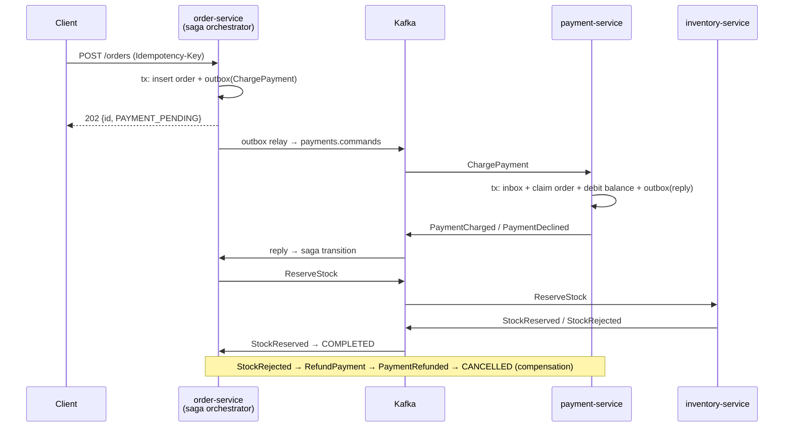

# spring-kafka-order-saga

An order checkout split across three **Spring Boot 4 / Java 25** services that coordinate over **Kafka**. No distributed transactions are involved. Each service owns its database, and consistency comes from:

- a saga with compensation
- a transactional outbox
- idempotent consumers
- dead-letter topics that can be replayed

The guarantees are checked by tests against real Kafka and Postgres, and by a chaos run that kills services and the broker.

## Try it in 3 minutes

**You need:** Docker with Compose v2, and `make`. Java and Maven run in containers.

```bash
git clone https://github.com/msalimcengiz/spring-kafka-order-saga && cd spring-kafka-order-saga
make demo    # fresh stack, 9 checked steps (below); the first run builds the images
make test    # 21 unit + Testcontainers integration tests (real Kafka and Postgres); or `mvn verify` with Java 25
make bench   # throughput and end-to-end saga latency, no faults (~10 min)
make chaos   # SIGKILL services and the broker under load, then check money and stock
make down
```

`make demo` prints each step and fails if something does not behave as described:

1. **Happy path:** the order is charged and stock is reserved, all over Kafka. The balance and stock change by exactly the order amount.
2. **Idempotency:** the same `Idempotency-Key` returns the same order, and the customer is charged once.
3. **Decline:** with not enough money, the order is cancelled and the balance is untouched.
4. **Compensation:** when stock runs out after payment, the states go `PAYMENT_PENDING → STOCK_PENDING → REFUND_PENDING → CANCELLED`. The payment is `REFUNDED`, the balance is restored, and stock never goes below 0.
5. **Validation:** a missing `Idempotency-Key` or an invalid body gets `400`.
6. **Outage:** with payment-service stopped, the order is accepted (`202`) and its command waits in Kafka.
7. payment-service comes back and the saga finishes, without the client retrying.
8. **Poison record:** an unparseable record goes straight to `payments.commands.DLT`, without retries.
9. Consumers keep working, and the metrics show the saga transitions.

To explore by hand: [`requests.http`](requests.http).

| Port | Service |
|---|---|
| 8081 | order-service (orders API) |
| 8082–8083 | payment-service ×2 (`/accounts/{id}`, `/payments/{orderId}`, DLT replay) |
| 8084–8085 | inventory-service ×2 (`/products/{id}`) |
| 29092 | Kafka (from the host) |
| 5436 | Postgres (`saga` / `saga`; databases `orders`, `payments`, `inventory`) |



## Benchmark

`make bench` ([`bench/run.sh`](bench/run.sh)) runs without injected faults. Balances and stock are topped up first, so every order takes the full path: charge, reserve, complete.

- **Capacity run:** 64 clients post orders back to back for 60 s.
- **Fixed-rate runs:** 100 and 500 orders/s for 60 s each, to measure latency below saturation.

**Saga latency** runs from the moment the order is created to `COMPLETED`. Both timestamps come from order-service's Postgres clock. The path in between is: outbox relay → payment-service → reply → outbox relay → inventory-service → reply.

| run | orders | accepted/s | POST p95 | completed sagas/s | saga p50 | saga p95 | saga p99 | not completed |
|---|---:|---:|---:|---:|---:|---:|---:|---:|
| 64 clients, closed loop | 258,686 | 4,310 | 29 ms | **833** | – | – | – | **0** |
| 100 orders/s | 6,001 | 100 | 3 ms | 100 | **253 ms** | **380 ms** | 429 ms | **0** |
| 500 orders/s | 29,978 | 500 | 5 ms | 498 | **320 ms** | **488 ms** | 827 ms | **0** |

**Capacity:** about 830–910 complete sagas per second. Two capacity runs gave 833 and 913. Each saga is 4 Kafka messages and 5 Postgres transactions across 3 services, not counting the outbox relays' batched updates. The API accepts orders about 5× faster than that, because it only writes the order and its outbox row. During the capacity run the extra orders queue up in the outbox and in Kafka, and are worked off afterwards. No order was lost or left pending, so saga latency in that run is mostly time in the queue and is not shown.

**Setup:** Apple M4. A Docker VM with 4 CPUs and 8 GiB runs the whole stack: 1 order-service, 2 payment-service, 2 inventory-service, a single Kafka broker with 6 partitions, 1 Postgres. Raw k6 output is in [`bench/results/`](bench/results/).

## Chaos test

`make chaos` runs a k6 load of 20 VUs for 90 s. Every order carries an `Idempotency-Key`, and clients retry with the same key. During the run:

- Every 5 s, random instances of all three services are killed with `SIGKILL`.
- The **Kafka broker is killed once**.
- 5% of handler attempts fail on purpose.

When everything settles, invariants are checked across the three databases:

| orders | completed | declined (no money) | out of stock (refunded) |
|---:|---:|---:|---:|
| 15,516 | 664 | 13,328 | 1,524 |

| check (28 service instances and the broker killed) | violations |
|---|---:|
| sagas not finished | **0** |
| acknowledged orders missing | **0** |
| payment does not match the order's outcome (charged / refunded / declined) | **0** |
| customers whose balance ≠ 5000 − sum of their completed orders | **0** |
| products whose stock ≠ 100 − sum of completed quantities | **0** |
| stock reserved for an order that did not complete | **0** |
| records in dead-letter topics | **0** |

The demo data is deliberately small: 100 customers with 5,000 each and 20 products with 100 units each. Money and stock run out early in the run, so most orders go through the decline path and **1,524 go through the full compensation path** (charged → out of stock → refunded → cancelled). That is the path that matters most under failure.

## How each failure is handled

| Failure | Mechanism |
|---|---|
| Process dies between the DB write and the Kafka publish | **Transactional outbox.** The command is written in the same transaction as the state change, and `OutboxRelay` publishes it afterwards with `acks=all` and an idempotent producer. A row is marked published only after Kafka acknowledged it. |
| Two relay instances reorder one order's messages | A **transaction-scoped advisory lock** lets one relay instance publish at a time. Messages are keyed by order id, so all messages for one order use the same partition. |
| A row with a lower id commits after the relay read | The relay marks **exactly the ids it sent** (`id = ANY(?)`), not `id BETWEEN first AND last`, which would mark an unsent row as published. |
| Consumer dies after the DB commit but before the offset commit | **Inbox table.** The message id is inserted in the same transaction as the side effects, so the redelivered record is a no-op. |
| The same command is delivered to two consumers at once (rebalance) | **Business idempotency.** Payment and inventory first claim the order with `INSERT … ON CONFLICT DO NOTHING` on the order id, so only one transaction can debit. A repeated command re-sends the original answer. |
| Overselling under concurrency | A conditional decrement, `UPDATE … SET available = available - ? WHERE available >= ?`. Postgres `CHECK (>= 0)` is the backstop. |
| Transient errors | Blocking retries with exponential backoff (200 ms → 10 s). Retry *topics* are deliberately not used: they let later messages for the same order overtake the failing one, and the saga depends on per-order order. |
| Poison message (bad JSON, unknown type) | Not retryable, so it goes **straight to `<topic>.DLT` on the same partition** and the partition keeps flowing. |
| Replaying dead letters | `POST /admin/dlt/replay?topic=…` (admin token). It snapshots end offsets first, so a record that fails again returns to the DLT instead of looping. A dedicated consumer group remembers progress. |
| A participant is down for long, or a reply was dead-lettered | The **stuck-saga sweeper** re-sends the current command for orders pending longer than `saga.stuck-after`, using `FOR UPDATE SKIP LOCKED`. This is safe because every command is idempotent. |
| Duplicate or late replies | The saga is a pure state machine ([`OrderSaga`](order-service/src/main/java/com/msalimcengiz/saga/order/OrderSaga.java)). A reply that does not fit the current state is ignored. |
| Client retries `POST /orders` | A unique `Idempotency-Key` returns the original order (`200`) instead of creating a second one. |

### Bugs the tests caught

- **DLT replay looped forever.** A poison record it republished failed again, landed back in the DLT and was read again by the same replay run. The replay now fixes end offsets before it starts, and the test covers it. The test went from 534 s, timing out, to 11 s.
- **Outbox gap.** The first version marked `id BETWEEN first AND last` as published. That can skip a row whose transaction took a lower id but committed later. It now marks the exact ids it sent.

## Tests

`make test` runs `mvn verify`. Testcontainers starts real Kafka 4.2 (KRaft) and Postgres 17. There are 21 tests:

- **Saga state machine (9 unit tests):** every transition, ignored replies, and the retry command for each state.
- **order-service:**
  - The same Idempotency-Key creates exactly one order and one command.
  - Happy path ends in COMPLETED.
  - Out of stock leads to a refund and then CANCELLED, and a duplicate reply is ignored.
  - The stuck-saga sweeper re-sends a command.
- **payment-service:**
  - Redelivery and re-sent commands charge once.
  - Insufficient funds keeps the balance.
  - A refund is applied once.
  - A poison record goes to the DLT without blocking its partition.
  - DLT replay is authorised, does not loop, and the replayed command is processed.
- **payment-service, transient failures:** with **half of all attempts failing**, 30 orders are each charged exactly once.
- **inventory-service:**
  - 40 concurrent reservations compete for 100 units: exactly 33 succeed and stock ends at 1, never below 0.
  - A repeated command returns the original answer.

## Run it

Only Docker is required.

```bash
make up
curl -XPOST localhost:8081/orders -H 'Idempotency-Key: checkout-42' -H 'content-type: application/json' \
  -d '{"customerId":"c001","productId":"p001","quantity":2,"amount":"149.90"}'
curl localhost:8081/orders/<id>
make test      # 21 tests, Testcontainers
make chaos     # the run above
```

Each service exposes `/actuator/health/{liveness,readiness}` and `/actuator/prometheus`. Metrics include `saga_outbox_backlog`, `saga_inbox_duplicates_total`, `saga_transitions_total{to}`, `saga_commands_resent_total`, `payment_declined_total{reason}`, and Kafka consumer lag from the client metrics.

## Layout

```
common/             messages (sealed interface + records), outbox writer/relay, inbox,
                    error handler + DLT, DLT replay endpoint, fault injection, shared config
order-service/      REST API, OrderSaga state machine, reply listener, stuck-saga sweeper
payment-service/    idempotent charge/refund against account balances
inventory-service/  idempotent, oversell-proof stock reservation
bench/              k6 load for throughput and saga latency
chaos/              k6 load + kill script + invariant checks
deploy/k8s/         Deployments with PDBs, probes, non-root, read-only root filesystem
```

Kubernetes is configured for **replication factor 3 and `min.insync.replicas=2`**, so one Kafka broker can fail without losing acknowledged writes. Local runs use a single broker.

## License

MIT
